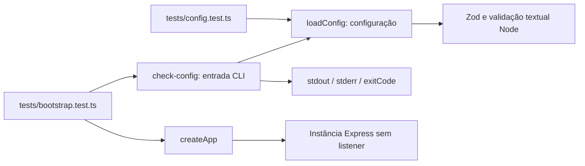

# Arquitetura

## Estado

**Etapa 2:** estão implementados um módulo puro de configuração, um comando de
conferência e uma fábrica Express sem rotas ou listener. Os símbolos reais estão
em [classes.md](classes.md); testes e resultados em [testing.md](testing.md).
Autenticação, caminhos de recursos, operações de arquivos, handlers, HTTPS, emissão
de certificados e CORS continuam planejados. Campos dessas funcionalidades já
podem ser analisados pela configuração, mas não as executam. Os dez endpoints
ainda não estão expostos.

## Componentes implementados e dependências

| Componente e fonte | Responsabilidade atual | Dependências |
| --- | --- | --- |
| Configuração — [config/index.ts](../src/config/index.ts), `loadConfig` | Receber argumentos/ambiente; validar valores/relações lexicais; retornar configuração imutável ou `ConfigurationError` | Zod, `node:net.isIP`, `node:path.posix` e análise textual `URL`; sem Express |
| Conferência CLI — [check-config.ts](../src/check-config.ts), bloco principal | Obter entradas do processo, chamar `loadConfig`, escrever diagnóstico seguro e definir término | Configuração e APIs do processo; não importa/instancia aplicação |
| Composição HTTP inicial — [app.ts](../src/app.ts), `createApp` | Criar Express e desabilitar `x-powered-by` | Express; não recebe configuração nem registra funcionalidades |



As setas indicam uso, não inicialização de servidor. `createApp` ainda não possui
consumidor de produção; sua composição é exercitada em subprocesso pelo teste de
bootstrap. Não há contêiner de injeção, serviço de arquivos ou classe genérica
criada para funcionalidades futuras.

## Fluxos atuais

O script npm `check:config` executa o JavaScript compilado `dist/check-config.js`:

1. Obter `process.argv.slice(2)` e `process.env`.
2. Chamar `loadConfig`: rejeitar argumentos inválidos e nomes desconhecidos
   `PASSA_`; selecionar CLI > ambiente > defaults para cada opção.
3. Derivar caminhos TLS padrão em `self-signed`, analisar tipos com Zod e verificar
   relações lexicais entre diretórios, materiais e bind/SAN.
4. Retornar configuração congelada ou lançar `ConfigurationError` com mensagens
   controladas, sem valores rejeitados.
5. A CLI informa o resultado: configuração inválida define código `2`, falha
   inesperada define `1`; execução válida termina normalmente com `0`.

A CLI descarta o retorno de configuração. Sua mensagem de sucesso informa que
diretórios/certificados/tokens não foram verificados e nenhum servidor foi iniciado.
O módulo CLI tem efeitos quando avaliado; `app` e `config` não abrem recursos de
rede ao importar. Separadamente, `createApp()` apenas aloca/configura Express;
não existe chamada a `listen`, servidor HTTPS ou handler de saúde nesse fluxo.

## Configuração versus preparação operacional

`loadConfig` é síncrona, recebe dados explicitamente e não faz I/O. Usa `node:net`
somente para validar IP e `URL` somente para analisar/canonicalizar texto, sem
consulta DNS ou conexão.

Caminhos de configuração são absolutos e normalizados lexicalmente, preservando
espaços. As relações usam componentes POSIX, não prefixo textual bruto. Isso não
demonstra a posição real de uma entrada após seguir links. A convenção relativa
e estrita dos caminhos públicos da API é outra responsabilidade, não implementada.

Permanecem pendentes: existência, tipo, propriedade e permissões; raiz efetiva;
links/aliases; relação efetiva com repositório e filesystem de staging; leitura ou
geração de tokens; validação/preparação de certificados. O módulo atual não recebe
caminho do repositório nem consulta o diretório corrente. Configuração sintaticamente
válida não equivale a preparação operacional concluída.

`ConfigurationError` estende `Error` sem código HTTP. A CLI traduz para stderr e
código de término. `application/problem+json`, descrito em [errors.md](errors.md),
continua contrato HTTP futuro, não a representação deste comando.

## Compilação e testes

A estrutura usa ESM (`type: module`), TypeScript `NodeNext`, target `ES2023`,
`strict`, `noUncheckedIndexedAccess`, `exactOptionalPropertyTypes` e
`verbatimModuleSyntax`. `src` compila para `dist`; produção executa JavaScript no
Node. A configuração de testes estende a principal, compila fontes/testes para
`.test-build` e usa `node --test`.

Express/Zod são dependências de execução; TypeScript/tipagens, de desenvolvimento.
Versões, lock e instalação ficam em [configuration.md](configuration.md). Não há
script `start` de servidor nesta etapa.

`tests/config.test.ts` chama `loadConfig` com entradas isoladas. Caminhos dos testes
são strings que o módulo não cria/lê. `tests/bootstrap.test.ts` executa CLI em
subprocessos e observa efeitos; cria um diretório temporário próprio para detectar
gravações indevidas e o remove após o teste. Outro caso instancia Express em
subprocesso e verifica ausência de listener ativo. Essa cobertura não equivale a
testes funcionais dos endpoints ou TLS.

## Componentes e responsabilidades previstas

A tabela abaixo descreve o desenho completo ainda planejado. Somente a análise de
configuração e a composição Express mínima descritas acima estão implementadas;
os nomes de componentes não obrigam a criar classes ou arquivos correspondentes.

| Componente | Responsabilidade | Dependências permitidas |
| --- | --- | --- |
| Configuração | Ler fontes, aplicar precedência, validar tipos e restrições antes da escuta | Zod e APIs de ambiente; sem dependência dos handlers |
| Inicialização e encerramento | Resolver raiz, preparar diretórios privados, certificados e tokens; compor aplicação e listener HTTPS; liberar recursos | Configuração, autenticação, aplicação, filesystem e TLS |
| HTTP | Rotear métodos/URLs, autenticar, validar query/headers/corpo, produzir status, headers e representação pública | Express, Zod, autenticação e operações de aplicação |
| Autenticação | Preparar e comparar credenciais; distinguir ausência/invalidez sem expor segredos | Criptografia do runtime e configuração; adaptador HTTP separado da verificação do token |
| Aplicação | Coordenar políticas de origem/destino, conflitos, exclusão, cópia e transferências | Caminhos, acesso ao filesystem e erros internos; sem tipos de Express |
| Caminhos | Validar o contrato relativo à raiz e a política de componentes/links | Raiz efetiva, inspeção controlada do filesystem e erros internos; sem Request/Response |
| Acesso ao filesystem | Executar inspeção, leitura, escrita, staging, publicação e limpeza com garantias documentadas | APIs do runtime; bibliotecas específicas só quando necessárias |
| Tradução de erros | Mapear falhas internas/validação para `application/problem+json`; tratar desconexões conforme fase da transferência | Erros internos e adaptador HTTP; sanitização de mensagens |

Tipos do HTTP não devem se propagar às regras de arquivos. Um teste de conflito de
destino, por exemplo, deverá chamar a operação correspondente com diretórios temporários,
sem precisar iniciar Express ou TLS. Dependências serão passadas na composição quando
necessário; não há justificativa aprovada para contêiner de injeção ou repositório genérico.

## Fluxo previsto de requisição

1. O listener HTTPS negocia TLS. O cliente verifica confiança e identidade do certificado.
2. O tratamento CORS identifica preflight e, para origem configurada, responde sem
   exigir o Bearer da operação. A requisição efetiva continua autenticada.
3. A autenticação valida `Authorization: Bearer TOKEN`, antes do parser de upload e
   antes de executar qualquer operação de arquivos, inclusive `/health`.
4. O adaptador HTTP valida localização, tipo e esquema dos campos. TypeScript não
   valida dados de rede em execução; Zod será responsável pelos esquemas.
5. A política de caminhos valida a entrada após uma única decodificação normal da URL
   e inspeciona origem, destino e componentes intermediários necessários.
6. A operação de aplicação coordena filesystem, conflitos e recursos temporários.
7. O HTTP envia metadados/bytes/status e traduz erros que ainda possam receber resposta.
   Depois dos headers, uma falha de transferência encerra o fluxo e libera recursos;
   não troca a resposta por JSON retroativamente.

O detalhamento de ordem dos middlewares deverá ser verificado contra Express e seus
parsers na implementação. Em particular, autenticação de upload não pode depender do
processamento integral do multipart.

## Direção das dependências planejada para o servidor

```text
Inicialização → configuração + TLS + autenticação + composição
HTTP → autenticação + validação + aplicação
Aplicação → política de caminhos + acesso ao filesystem + erros internos
Tradução HTTP → erros internos
```

Erros internos não devem importar Express. A configuração implementada não inicia
listeners como efeito colateral de importação. Montagem da aplicação e abertura
da porta permanecem responsabilidades distintas, permitindo testes internos nas
etapas 3–7.

## Transporte, recursos e concorrência

HTTPS é obrigatório no modo normal; não haverá listener HTTP nem redirecionamento.
A integração real do transporte será verificada na etapa 8. Até lá, a aplicação
testável não deve ser apresentada como servidor pronto para uso.

Download, recebimento de upload e geração/transferência ZIP deverão processar dados
incrementalmente. Uma Promise não torna uma operação automaticamente streaming ou
atômica. Temporários serão privados e terão ciclo de vida vinculado à operação.

O processo inicial será único. Eventual exclusão mútua de mutações dentro dele é uma
proposta de implementação, insuficiente para impedir mudanças externas. Staging e
publicação deverão respeitar o filesystem do destino. Operações recursivas não têm
garantia geral de transação ou snapshot. Consulte [filesystem.md](filesystem.md).

## Escolhas e fontes

- Express é o framework HTTP escolhido; sua API recebe requisições/respostas e não
  impõe a arquitetura das regras de arquivos. [API Express 5](https://expressjs.com/en/5x/api.html).
- Zod valida dados em execução e requer configuração TypeScript estrita conforme
  sua documentação. [Introdução do Zod](https://zod.dev/).
- TypeScript fornece tipagem estática; as verificações de tipos não substituem
  validação de entrada. [TypeScript Handbook](https://www.typescriptlang.org/docs/handbook/2/basic-types.html).
- O uso de `node:https`, `node:tls`, `node:crypto`, `node:fs` e streams na produção
  permanece planejado para as respectivas etapas. [Documentação Node.js 24](https://nodejs.org/docs/latest-v24.x/api/).

As versões consultadas e decisões de módulos, compilação e dependências estão em
[configuration.md](configuration.md) e [decisions.md](decisions.md).
