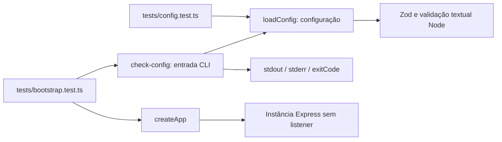

# Arquitetura do passa-arquivo

O passa-arquivo é um sistema Peer-to-Peer (P2P): os dispositivos se conectam
entre si, sem depender de um servidor central para guardar seus arquivos.
A API desta branch é o módulo central do software instalado em cada máquina;
isso não significa um servidor central obrigatório na rede.

Cada instalação poderá receber e iniciar conexões. Seus arquivos continuarão
sob uma raiz compartilhada local, e a identidade do dispositivo será seu
certificado persistente. As plataformas alvo são Linux Mint, Ubuntu e Windows.

## Componentes do sistema

| Componente | Responsabilidade |
| --- | --- |
| API central | Descoberta, pareamento, verificação dos peers, persistência e operações de arquivos. |
| Interface do usuário | Mostrar candidatos e pedidos; permitir ativar a descoberta, informar o código, aceitar ou recusar. Ainda não existe nesta branch. |
| Outros componentes do ecossistema | Poderão existir em branches órfãs separadas do mesmo repositório. Seus nomes e responsabilidades adicionais ainda não foram definidos. |

Uma branch órfã começa com histórico independente. Essa organização do Git não
cria isolamento de segurança entre processos nem define a comunicação entre os
componentes. Nenhuma nova branch faz parte da configuração disponível hoje.

## Três responsabilidades de conexão

| Parte | Quem inicia | Limite |
| --- | --- | --- |
| Controle local | Usuário da máquina | Abrir e fechar descoberta, escolher redes e confirmar pedidos; proteção local ainda a definir. |
| Descoberta e pareamento | Usuários dos dois dispositivos | Entrada temporária para encontrar candidatos e confirmar confiança; sem acesso a arquivos. |
| Operações entre peers conhecidos | Dispositivos com confiança bilateral concluída | Conexões HTTPS com mTLS e verificação da identidade persistida. |

A entrada provisória `/connect` só ficará disponível para novos pareamentos
quando a descoberta estiver ativa. Sua ativação precisa vir de um comando local,
pois um serviço de rede fechado não recebe a própria ordem de abertura.
Fechar a descoberta não remove peers salvos.

O fluxo humano e os limites da busca estão em [Conectar dispositivos](connection.md).
A separação entre certificados apresentados e confiáveis está em
[Segurança](security.md), e o modelo de persistência em [Dispositivos conhecidos](peers.md).

## Código disponível hoje

O código tem três partes: uma função que confere a configuração, um comando para
usar essa função no terminal e uma função que cria a aplicação Express. A aplicação
ainda não recebe requisições nem acessa os arquivos compartilhados.

Este guia explica como essas partes se conectam. Para consultar funções, tipos
e campos individuais, veja [Módulos e funções](classes.md).

## Os três arquivos principais

| Arquivo | O que faz | O que usa |
| --- | --- | --- |
| [config/index.ts](../src/config/index.ts) | `loadConfig` confere os valores recebidos e devolve a configuração ou um erro | Zod e funções do Node.js para analisar IPs, URLs e caminhos |
| [check-config.ts](../src/check-config.ts) | Lê os argumentos do terminal e as variáveis de ambiente, chama `loadConfig` e mostra o resultado | Módulo de configuração e informações do processo Node.js |
| [app.ts](../src/app.ts) | `createApp` cria uma aplicação Express com o cabeçalho `x-powered-by` desabilitado | Express |

As setas mostram qual parte usa a outra. No diagrama, CLI significa comando de
terminal; `stdout` e `stderr` são as saídas de mensagens comuns e de erro, e
`exitCode` é o número que indica como o comando terminou. Um *listener* é um
servidor esperando conexões em uma porta. Nenhum desses arquivos abre uma porta.

`check-config` não chama `createApp`. A função `createApp` é usada somente pelos
testes; ainda não há um comando que a conecte a um servidor HTTPS.

## O que acontece ao conferir a configuração

Depois da compilação, `npm run check:config -- ...` executa
`dist/check-config.js`. O caminho percorrido é este:

1. O comando obtém os argumentos de `process.argv.slice(2)` e as variáveis de
   ambiente de `process.env`.
2. `loadConfig` rejeita argumentos inválidos e variáveis desconhecidas que
   começam com `PASSA_`. Para cada opção, usa o argumento do terminal, a variável
   de ambiente ou o valor padrão, nessa ordem.
3. No modo `self-signed`, calcula os caminhos padrão do certificado e da chave
   quando eles não foram informados. Zod confere os tipos dos valores e as
   combinações entre opções, como as pastas e os endereços do certificado.
4. Se houver um problema, a função lança `ConfigurationError`. Caso contrário,
   devolve um objeto que não pode ser alterado, incluindo suas listas.
5. O comando mostra o resultado e termina com código `0` no sucesso, `2` para
   configuração inválida ou `1` para uma falha inesperada. As mensagens não
   reproduzem os valores recebidos.

O comando descarta o objeto retornado: sua finalidade é conferir as opções.
Ele não cria diretórios, lê tokens, prepara certificados ou inicia o servidor.

Importar `check-config` já executa esse comando. Importar `app` ou `config` apenas
disponibiliza suas funções e tipos, sem executar o comando ou abrir conexões.

## Conferir um caminho não é abrir o arquivo

`loadConfig` trabalha somente com os dados que recebe. Por exemplo, consegue
reduzir `/dados/pasta/../arquivos` a `/dados/arquivos`, mas não verifica se essa
pasta existe. Também preserva os espaços que fazem parte dos nomes.

Para comparar caminhos, considera cada pasta do caminho: `/dados/a` não contém
`/dados/ab`. Essa comparação é feita sobre o texto. Um link simbólico pode apontar
para outro local no disco, e essa função não segue nem inspeciona links.

Ela também não confere tipo de arquivo, dono, permissões, relação com a pasta do
repositório ou se dois caminhos estão no mesmo sistema de arquivos. Não consulta
o diretório de trabalho atual. Ao analisar um IP ou uma URL, não faz consultas
DNS nem conexões de rede.

Por isso, uma configuração aceita ainda pode se referir a uma pasta inacessível,
um token ausente ou um certificado inválido. A leitura desses recursos e a
validação dos caminhos enviados à API ainda não existem.

`ConfigurationError` é um erro usado pelo comando de terminal. Ele não tem um
status HTTP. O formato `application/problem+json` descrito em [Erros](errors.md)
será usado pelas respostas da API, que ainda não estão disponíveis.

## Como o código é compilado e testado

O projeto usa módulos JavaScript com `import` e `export` (ESM). O TypeScript
segue as regras de módulos do Node.js com `NodeNext`, gera JavaScript para
`ES2023` e grava o resultado de `src` em `dist`.

As opções `strict`, `noUncheckedIndexedAccess` e `exactOptionalPropertyTypes`
ajudam a identificar usos de valores ausentes e tipos incompatíveis.
`verbatimModuleSyntax` mantém a distinção entre importações de valores e de tipos.
Veja a configuração completa em [tsconfig.json](../tsconfig.json).

Express e Zod são usados na execução. TypeScript e os pacotes de tipos são usados
no desenvolvimento. As versões e os comandos de instalação estão em
[Configuração](configuration.md). Não existe um script `start` para iniciar a API.

A configuração dos testes compila fontes e testes para `.test-build` e usa
`node --test` para executá-los:

- [config.test.ts](../tests/config.test.ts) chama `loadConfig` com dados de teste.
  Os caminhos são apenas textos; a função não lê nem cria essas pastas.
- [bootstrap.test.ts](../tests/bootstrap.test.ts) executa o comando em processos
  separados e verifica suas saídas. Usa uma pasta temporária própria para
  detectar gravações indevidas e a remove ao terminar. Também confere que criar
  a aplicação Express não abre um servidor.

Esses testes não cobrem requisições da API ou conexões HTTPS. Consulte
[Testes](testing.md) para saber como executá-los.

## Organização interna prevista

As responsabilidades abaixo ainda precisam de implementação. Os nomes descrevem
partes do sistema, não classes já existentes.

| Parte | Responsabilidade |
| --- | --- |
| Identidade local | Preparar chave e certificado na instalação e preservá-los ao reiniciar. |
| Descoberta | Validar alvos locais, limitar a varredura, reunir candidatos e encerrar a janela temporária. |
| Pareamento | Associar pedido, certificados e código; obter aceite; confirmar os dois lados sem liberar arquivos antes da hora. |
| Registro de peers | Guardar nome, certificado e horários; atualizar conexão conhecida sem usar IP como identidade. |
| Transporte mTLS | Conferir os certificados e a prova de posse das chaves conforme o contexto de pareamento ou uso normal. |
| HTTP e validação | Interpretar método, rota, parâmetros e corpo com Express e Zod; representar respostas de forma consistente. |
| Operações de arquivos | Coordenar consultas, envio, cópia, movimentação e exclusão dentro da raiz local. |
| Acesso ao sistema operacional | Tratar caminhos, links, permissões, arquivos abertos e encerramento nativos de Linux e Windows. |
| Configuração e erros | Conferir valores, descrever falhas sem segredos e separar erros TLS, HTTP e do processo local. |

As regras de arquivos não precisarão conhecer `Request` ou `Response` do Express.
A lógica de pareamento também deve distinguir a decisão do usuário local das
mensagens recebidas de um candidato remoto. Um pedido remoto não poderá iniciar
varreduras arbitrárias ou confirmar seu próprio aceite.

## Uso depois do pareamento

1. A encontra um endereço atual de B; esse endereço é apenas uma localização.
2. A e B estabelecem mTLS e conferem o certificado salvo do outro dispositivo,
   a posse da chave correspondente e a política de validade.
3. Só depois de concluir a verificação mútua uma requisição chega às operações
   de arquivos. `/health` também não funciona como atalho de descoberta pública.
4. Zod confere parâmetros e corpo. As regras de caminhos verificam origem,
   destino e pastas intermediárias necessárias.
5. A operação processa os dados por partes, respeita limites e limpa temporários.
6. O servidor envia a resposta. Uma falha após o começo de um download encerra
   a transferência; não acrescenta JSON ao arquivo.

A autenticação ocorre antes de acessar arquivos. Uma falha durante o handshake
pode encerrar a conexão antes de existir uma requisição HTTP, como explicado em
[Erros](errors.md).

## Portabilidade e concorrência

Os caminhos da API terão o mesmo formato nos dois sistemas; os caminhos locais,
permissões e mecanismos de publicação precisam respeitar o sistema operacional.
Não se pode obter suporte a Windows apenas trocando o separador de pastas.
Veja [Linux e Windows](platforms.md).

Cada instância usará um único processo. Durante envio, cópia e movimentação, a
aplicação deverá permitir leitura e edição por outros programas, respeitando as
restrições do sistema operacional. Não deverá impor bloqueio exclusivo sobre
esses arquivos. A forma de coordenar requisições simultâneas da própria API ainda
precisa ser definida; uma trava interna não controla alterações externas.
Conteúdo lido durante uma edição pode não representar uma versão fixa do arquivo.

Uploads e cópias deverão preparar o resultado em uma área privada antes de
colocá-lo no destino. Operações recursivas não garantem desfazer tudo em caso de
falha nem representar todos os arquivos no mesmo instante. Os limites ficam em
[Arquivos e pastas](filesystem.md).

## Referências das bibliotecas

- [Express 5](https://expressjs.com/en/5x/api.html): tratamento de requisições e respostas HTTP.
- [Zod](https://zod.dev/): validação dos dados durante a execução.
- [TypeScript](https://www.typescriptlang.org/docs/handbook/2/basic-types.html): verificação dos tipos durante o desenvolvimento.
- [Node.js 24](https://nodejs.org/docs/latest-v24.x/api/): funções de rede, arquivos e criptografia. O uso de `node:https`, `node:tls`, `node:crypto`, `node:fs` e streams no código da API ainda precisa ser implementado.
